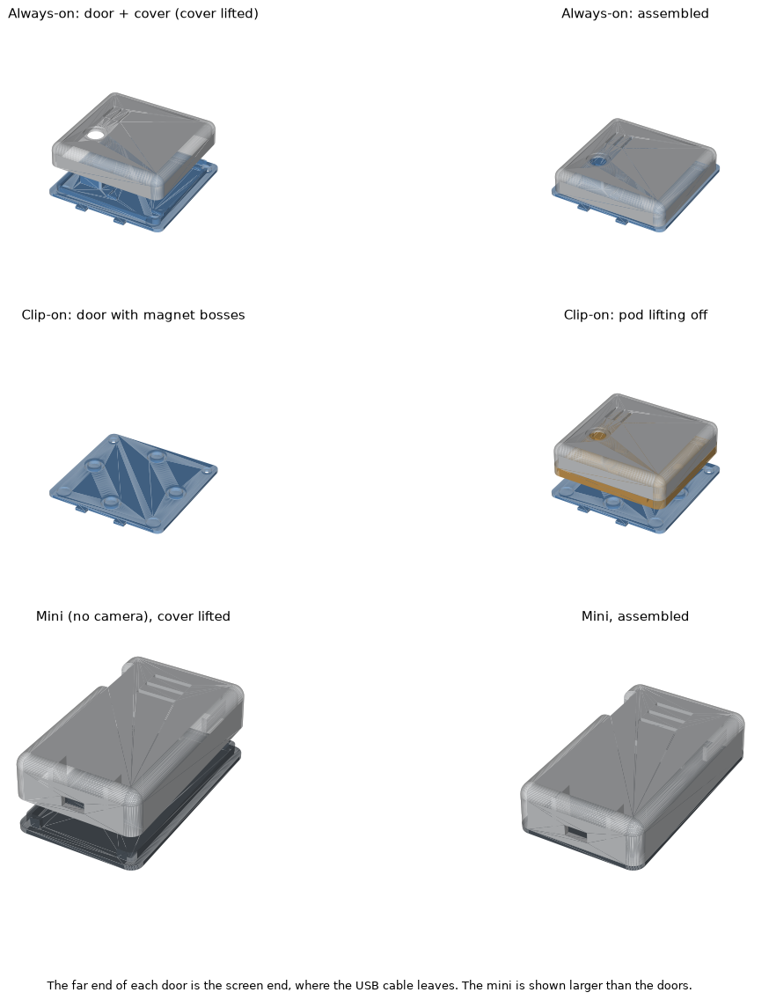
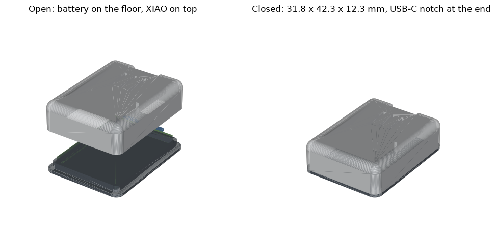
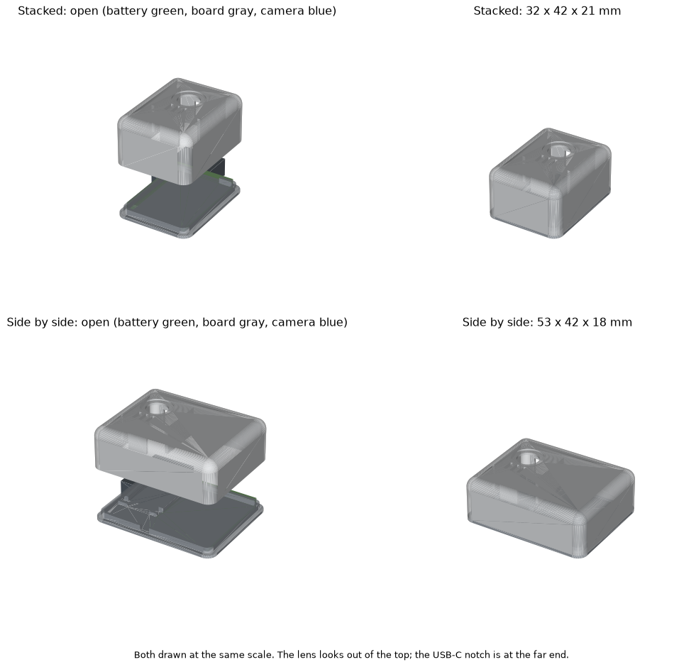

# Cases for the TI-84 Plus CE dongle

Three cases, all 3D-printed, generated by `make_case.py`:

| Version | What it is | Sticks out from the calculator |
|---|---|---|
| **Always-on** | A replacement battery door with the dongle built in. Screw it on and leave it. | about 11 mm |
| **Clip-on** | A replacement battery door you screw on once, plus a dongle pod that snaps on with magnets and pulls straight off. | 3 mm with the pod off, about 15 mm with it on |
| **Back plate (camera)** | A thin plate over the whole back of the calculator, gripping its long edges. Everything lies flat in one low raised area at the top: the W11, its camera unfolded beside it, and the battery. The area is open toward the calculator so nothing is wasted there. Calculator size, edge grip and the W11's height are estimates. | 1.6 mm plate, 8.4 mm at the raised area |
| **Camera box** | A standalone box for the Meshnology W11 with its camera board snapped on, lens looking out the top, battery inside. Two shapes: **stacked** (32 × 42 × 21 mm, battery under the board) and **side by side** (53 × 42 × 18 mm). Stack height and lens position are estimates. | n/a |
| **Mini** | A small box, 31.8 × 42.3 × 12.3 mm, for a plain XIAO ESP32S3 (no camera) and the battery, on the end of the USB cable. | n/a |







Renders: [`renders/`](renders/) (back plate and camera box).

The doors are the same thickness as the original, so they sit flush with the case,
and nothing goes past the outline of the original door. On top is one smooth, rounded
cover with a round lens window. To keep it that low, the camera is **unfolded from the
top of the XIAO and laid beside the board** on its ribbon cable instead of stacked on
top. That takes the stack from about 15 mm to about 9 mm.

## Parts

| Part | For | Notes |
|---|---|---|
| Seeed XIAO ESP32S3 **Sense** | Doors | The camera version |
| Seeed XIAO ESP32S3 (plain) | Mini | No camera; the firmware is the same, Photo just says "Camera not found" |
| Thin double-sided foam tape | Mini | Between the battery and the board |
| [EEMB 402535 LiPo, 3.7 V 320 mAh](https://www.amazon.com/EEMB-402535-Rechargeable-Connector-Certified/dp/B08215N9R8) | Doors and mini | 25.5 × 36 × 4.3 mm, built-in protection. [4-pack](https://www.amazon.com/EEMB-402535-Rechargeable-Connector-Certified/dp/B08HD1N273) |
| [6 × 2 mm N52 disc magnets](https://www.amazon.com/rhinocats-N52-6x2mm-Small-Magnets/dp/B0HB4263KK), 8 of them | Clip-on | Four in the door, four in the pod. Super glue holds them |
| Short right-angle USB-C to mini-USB **OTG** cable | All | Must be OTG so the calculator acts as the host |

The XIAO charges the battery whenever the calculator powers it, so you never charge the
dongle separately. That charging comes out of the calculator's battery.

## The door's measurements

No one publishes the TI-84 Plus CE battery door's dimensions, so these were measured
from a straight-on photo in [iFixit's battery guide](https://www.ifixit.com/Guide/Texas+Instruments+TI-84+Plus+CE+Battery+Replacement/63973),
using the calculator's published 86.9 mm (3.42 in) width as the ruler. Expect up to
about 1 mm of error.

| Setting | Value | What it is |
|---|---|---|
| `DOOR_WIDTH` × `DOOR_LENGTH` | 63.4 × 60.4 mm | The door, edge to edge |
| `DOOR_CORNER_RADIUS` | 3.8 mm | |
| `SCREW_INSET`, `SCREW_FROM_TOP` | 6.6 mm, 5.5 mm | Two captive Phillips screws at the top (screen-end) corners, about 50 mm apart |
| `FOOT_INSET`, `FOOT_FROM_BOTTOM`, `FOOT_DIAMETER` | 6.3, 7.8, 7.2 mm | The calculator's two rubber feet sit in the door's bottom corners |
| `DOOR_THICKNESS` | 1.6 mm | **Guess**; measure it |
| `TAB_*` | 2 mm tongue | **Guess**: the bottom edge tucks under the case, since the door lifts out from the screw end |

The two screws are captive: they stay in the original door. Unscrew both, then work
them out of the old door to use in the new one. The rubber feet peel off and stick into
the new door's recesses (on the clip-on door; the always-on cover goes over them).

If you have calipers, measure the original door and correct these, especially the
thickness and the bottom tongue. Then rebuild:

```bash
.venv/bin/python case/make_case.py
```

The XIAO sizes are estimates too. Once you have the board, check `STACK_HEIGHT` (the
board plus the expansion board, with the camera unfolded) and the camera module
sizes. If something doesn't fit, the script stops and says what's too big.

## Print

**Bambu Lab printers:** send `case/mini_box.3mf` with `case/mini_box_print_notes.txt`.
The 3MF has both mini-box parts on one plate, ready to slice in Bambu Studio. Rebuild it
after changing the case with `.venv/bin/python case/make_3mf.py`.


Print **`stl/fit_test.stl` first**: it's just the door plate (about 10 minutes). It should
drop into the recess with the screw lined up. Adjust and reprint until it fits.

| File | Orientation |
|---|---|
| `always_on/door_base.stl`, `clip_on/door_magnets.stl`, `clip_on/pod_base.stl`, `mini/mini_base.stl` | As exported, flat side down |
| `always_on/cover.stl`, `clip_on/cover.stl`, `mini/mini_cover.stl` | As exported, top face down (open side up) |

No supports needed. PLA or PETG, 0.2 mm layers, 3 walls, 20% infill. PETG holds up
better in a hot car or backpack. White or light gray matches the calculator's back.

## Assemble

**Doors (both versions)**

1. Solder the battery: cut its connector off, then red to **B+** and black to **B−** on
   the underside of the XIAO, one wire at a time so the bare ends never touch.
2. Unclip the camera module from the top of the XIAO's camera board and lay it
   beside the board, keeping the ribbon plugged in. Set it lens-up in the square pocket
   on the pedestal.
3. Set the XIAO in its corner (USB-C at the top, toward the screen end) and the battery
   in its spot. The low ribs hold them; a little double-sided foam tape stops rattles.
4. Press the cover on. The lens should sit in the round window; if it's off, change
   `CAMERA_GAP` and reprint the base.

**Always-on:** swap the base onto the calculator in place of the battery door and put
the two screws in before pressing the cover on (the screws sit under the cover).

**Clip-on:**

1. Glue a magnet into each of the four bosses on the door (one in the middle of each
   edge) and each of the four pockets under the pod. Before the glue sets, stack each door magnet on its matching pod
   magnet so they attract: mark the facing sides with a marker and keep the marks up.
2. Screw the door on in place of the battery door. It stays.
3. Set the pod on the door. The bosses line it up and the magnets snap it down. To take
   it off, lift it straight up.

**Mini:** solder the battery to the XIAO the same way as for the doors. Lay the battery
in the base, wire end toward the USB-C notch. Put a layer of foam tape on the battery
and set the board on it, USB-C toward the notch. Press the cover on; rails inside it
keep the board from sliding.

Plug in the OTG cable and run it to the calculator's USB port at the top. Keep the
original battery door in case you want to go back.
